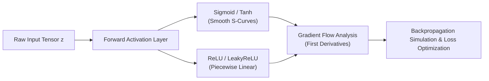

<p align="center">
  
</p>

<p align="center">
  
  
  
  
</p>

<a id="overview"></a>
## 📖 Executive Summary & Overview

Modern deep neural networks rely heavily on non-linear activation functions to transform affine vector spaces into arbitrary high-dimensional decision boundaries. Without proper activation dynamics, deep feed-forward networks collapse into simple linear regressions vulnerable to vanishing or exploding gradients.

The **Deep Learning Laboratory** repository contains experimental implementations, mathematical evaluations, and ethical research across deep learning architectures:
1. **Activation Functions Implementation:** Native Python and NumPy implementations of Sigmoid, Tanh, ReLU, and Leaky ReLU with derivative curves.
2. **Architecture Comparison:** Structural analysis comparing Multi-Layer Perceptrons (MLPs), Convolutional Neural Networks (CNNs), and Recurrent Neural Networks (RNNs).
3. **Ethical Considerations in Deep Learning:** Research report examining algorithmic bias, surveillance ethics, and generative IP concerns.

<a id="toc"></a>
## 📑 Table of Contents

- [📖 Executive Summary & Overview](#overview)
- [🎯 Key Features & Capabilities](#features)
- [🏗️ System Architecture & Pipeline](#architecture)
- [🛠️ Tech Stack Breakdown](#tech-stack)
- [⚙️ Reproducible Quickstart & Setup](#setup)
- [📁 Project Directory Layout](#project-layout)
- [👨‍💻 Author & Contributions](#author)

<a id="features"></a>
## 🎯 Key Features & Capabilities

- **Mathematical Activation Modeling:** Vectorized computation of:
  - $\text{Sigmoid}(z) = \frac{1}{1 + e^{-z}}$
  - $\text{Tanh}(z) = \frac{e^z - e^{-z}}{e^z + e^{-z}}$
  - $\text{ReLU}(z) = \max(0, z)$
  - $\text{Leaky ReLU}(z) = \max(\alpha z, z)$
- **Gradient Landscape Visualizations:** Dynamic Matplotlib plotting of primary transfer curves alongside first-order derivative plots to illustrate vanishing gradient regions.
- **Deep Architecture Comparative Benchmarking:** Evaluation of model parameter efficiency across CNN, RNN, and Transformer architectures.
- **AI Ethics Framework:** Critical analysis of data provenance, demographic parity, and generative entertainment ethics.

<a id="architecture"></a>
## 🏗️ System Architecture & Pipeline



<a id="tech-stack"></a>
## 🛠️ Tech Stack Breakdown

| Category | Tools & Libraries | Purpose |
| :--- | :--- | :--- |
| **Runtime** | Python 3.10+ | Mathematical modeling and script execution |
| **Numerical Libraries** | NumPy | High-performance tensor arithmetic |
| **Visualization** | Matplotlib | Activation curves, gradient slopes, and loss plots |
| **Notebook Platform** | Jupyter Notebook | Interactive computational lab environment |
| **Research Reports** | PDF / Word / PowerPoint | Deep technical documentation and industry analysis |

<a id="setup"></a>
## ⚙️ Reproducible Quickstart & Setup

### Prerequisites
- Python 3.8+ installed
- Virtual environment tool (`venv` or `conda`)

```bash
# 1. Clone repository
git clone https://github.com/Amaraiah11/Deep-learning.git
cd Deep-learning

# 2. Create virtual environment
python -m venv venv
venv\Scripts\activate   # On Windows
# source venv/bin/activate # On Linux/macOS

# 3. Install required packages
pip install numpy matplotlib jupyter

# 4. Launch notebook
jupyter notebook Project_5_DL.ipynb
```

<a id="project-layout"></a>
## 📁 Project Directory Layout

```text
Deep-learning/
├── AI_in_Entertainment (1).pptx                     # Executive presentation on AI in media
├── Ethical_Considerations_in_Deep_Learning+Report.pdf# Academic report on AI ethics & bias
├── Project3_DeepLearning_Architectures.docx          # In-depth architectural comparison
├── Project_5_DL.ipynb                               # Jupyter notebook: Activation functions
└── README.md                                        # Laboratory technical documentation
```

<a id="author"></a>
## 👨‍💻 Author & Contributions

This project is developed and maintained with high technical rigour by **Amaraiah C**, Software Engineer and Data Analytics Practitioner studying Bachelor of Computer Applications (BCA) at Alliance University.

- 🌐 **GitHub:** [@Amaraiah11](https://github.com/Amaraiah11)
- 💼 **LinkedIn:** [Connect on LinkedIn](https://www.linkedin.com/in/amaraiah-c/)
- 📧 **Institutional Contact:** `camaraiahBCA24@ced.alliance.edu.in`

### 🤝 Contribution Guidelines
Contributions, bug reports, and architectural discussions are welcome!
1. **Fork** the repository: `https://github.com/Amaraiah11/Deep-learning`
2. **Branch**: `git checkout -b feature/your-feature-name`
3. **Commit**: `git commit -m "feat: enhance feature logic"`
4. **Push**: `git push origin feature/your-feature-name`
5. **Open Pull Request** against the `Amaraiah-C` branch.

---

<p align="center">
  <b>⭐ If this codebase or documentation assisted your engineering workflows, please star the repository! ⭐</b>
</p>

<p align="center">
  
</p>
