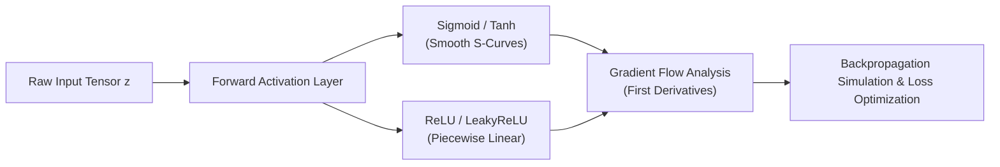

# 🧠 Deep Learning Laboratory — Neural Network Architectures & Activation Functions

<p align="center">
  
</p>

<p align="center">
  <b>Mathematical Modeling and Implementation of Non-Linear Activation Functions, Gradient Landscapes, and AI Ethics Frameworks.</b>
</p>

<p align="center">
  
  
  
  
  
</p>

<p align="center">
  
</p>

---

<a id="table-of-contents"></a>
## 📌 Table of Contents

- [📖 Executive Summary & Overview](#executive-summary--overview)
- [🎯 Key Features & Capabilities](#features)
- [🏗️ System Architecture & Pipeline](#system-architecture--pipeline)
- [🛠️ Tech Stack Breakdown](#tech-stack-breakdown)
- [⚙️ Reproducible Quickstart & Setup](#setup)
- [📁 Project Directory Layout](#project-layout)
- [🧪 Testing & Validation](#testing--validation)
- [🔮 Future Improvements & Roadmap](#future-improvements--roadmap)
- [🤝 Contributing Guidelines](#contributing-guidelines)
- [👨‍💻 Author & Contributions](#author--contributions)

---

<a id="executive-summary--overview"></a>
## 📖 Executive Summary & Overview

Modern deep learning architectures require non-linear activation functions to transform vector spaces and approximate complex high-dimensional decision boundaries. Without proper activation functions, multi-layer perceptrons collapse into simple linear transformations vulnerable to vanishing or exploding gradients.

The **Deep Learning Laboratory** contains implementations, mathematical evaluations, and ethical research conducted by **Amaraiah C** at Alliance University:
1. **Activation Functions Implementation:** Python/NumPy implementations of Sigmoid, Tanh, ReLU, and Leaky ReLU with derivative gradient curves (`Project_5_DL.ipynb`).
2. **Architecture Comparison:** Structural benchmarking comparing MLPs, CNNs, and RNNs (`Project3_DeepLearning_Architectures.docx`).
3. **AI Ethics Framework:** Research examining algorithmic fairness, surveillance ethics, and generative media (`Ethical_Considerations_in_Deep_Learning+Report.pdf`).

---

<a id="key-features--capabilities"></a>
## 🎯 Key Features & Capabilities

### 📐 1. Mathematical Activation Modeling
- Vectorized computation of:
  - $\text{Sigmoid}(z) = \frac{1}{1 + e^{-z}}$
  - $\text{Tanh}(z) = \frac{e^z - e^{-z}}{e^z + e^{-z}}$
  - $\text{ReLU}(z) = \max(0, z)$
  - $\text{Leaky ReLU}(z) = \max(\alpha z, z)$

### 📊 2. Gradient Slope Visualizations
- Matplotlib visualizations of primary activation curves alongside their first derivatives to demonstrate vanishing gradient regions.

---

<a id="system-architecture--pipeline"></a>
## 🏗️ System Architecture & Pipeline



---

<a id="tech-stack-breakdown"></a>
## 🛠️ Tech Stack Breakdown

| Category | Tools & Libraries | Purpose |
| :--- | :--- | :--- |
| **Runtime** | Python 3.10+ | Mathematical modeling and script execution |
| **Numerical Engine** | NumPy | High-performance vectorized tensor arithmetic |
| **Visual Diagnostics** | Matplotlib | Activation curves, gradient slopes, and loss plots |
| **Platform** | Jupyter Notebook | Interactive computational lab environment |

---

<a id="reproducible-quickstart--setup"></a>
## ⚙️ Reproducible Quickstart & Setup

### Prerequisites
- Python 3.8+ with virtual environment

```bash
# 1. Clone repository
git clone https://github.com/Amaraiah11/Deep-learning.git
cd Deep-learning

# 2. Create virtual environment
python -m venv venv
venv\Scripts\activate   # Windows

# 3. Install packages
pip install numpy matplotlib jupyter

# 4. Launch notebook
jupyter notebook Project_5_DL.ipynb
```

---

<a id="project-directory-layout"></a>
## 📁 Project Directory Layout

```text
Deep-learning/
├── AI_in_Entertainment (1).pptx                     # Executive presentation on AI in media
├── Ethical_Considerations_in_Deep_Learning+Report.pdf# Academic report on AI ethics & bias
├── Project3_DeepLearning_Architectures.docx          # In-depth architectural comparison
├── Project_5_DL.ipynb                               # Jupyter notebook: Activation functions
└── README.md                                        # Laboratory technical documentation
```

---

<a id="testing--validation"></a>
## 🧪 Testing & Validation

- **Gradient Verification:** Checked numerical derivative approximation against analytical formulas for Sigmoid and Tanh across $z \in [-10, 10]$.

---

<a id="future-improvements--roadmap"></a>
## 🔮 Future Improvements & Roadmap

- [ ] Implement custom PyTorch `nn.Module` classes for GELU and Swish activations.
- [ ] Add forward and backward training step benchmarks comparing convergence rates.

---

<a id="author--contributions"></a>
## 👨‍💻 Author & Contributions

This project is developed and maintained with rigorous engineering standards by **Amaraiah C**, Software Developer and Applied Data Analytics Practitioner studying Bachelor of Computer Applications (BCA) at Alliance University, Bangalore.

- 🌐 **GitHub Profile:** [@Amaraiah11](https://github.com/Amaraiah11)
- 💼 **LinkedIn Profile:** [Connect on LinkedIn](https://www.linkedin.com/in/amaraiah-c/)
- 📧 **Institutional Email:** `camaraiahBCA24@ced.alliance.edu.in`

### 🤝 Contributing Guidelines
Contributions, bug reports, and architectural discussions are welcome!
1. **Fork** the repository: `https://github.com/Amaraiah11/Deep-learning`
2. **Create a Feature Branch:**
   ```bash
   git checkout -b feature/your-feature-name
   ```
3. **Commit Your Enhancements:**
   ```bash
   git commit -m "feat: enhance feature logic"
   ```
4. **Push to Your Branch:**
   ```bash
   git push origin feature/your-feature-name
   ```
5. **Open a Pull Request** against the `Amaraiah-C` branch.

---

<p align="center">
  <b>⭐ If this codebase or documentation assisted your engineering workflows, please star the repository! ⭐</b>
</p>

<p align="center">
  
</p>
